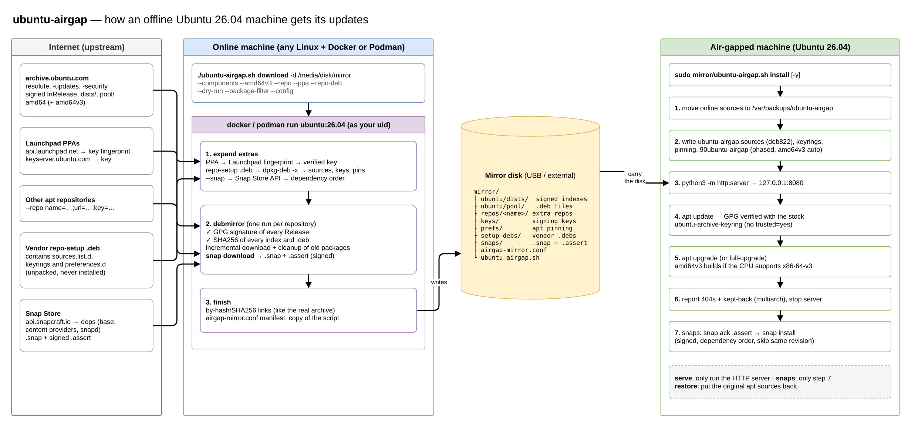
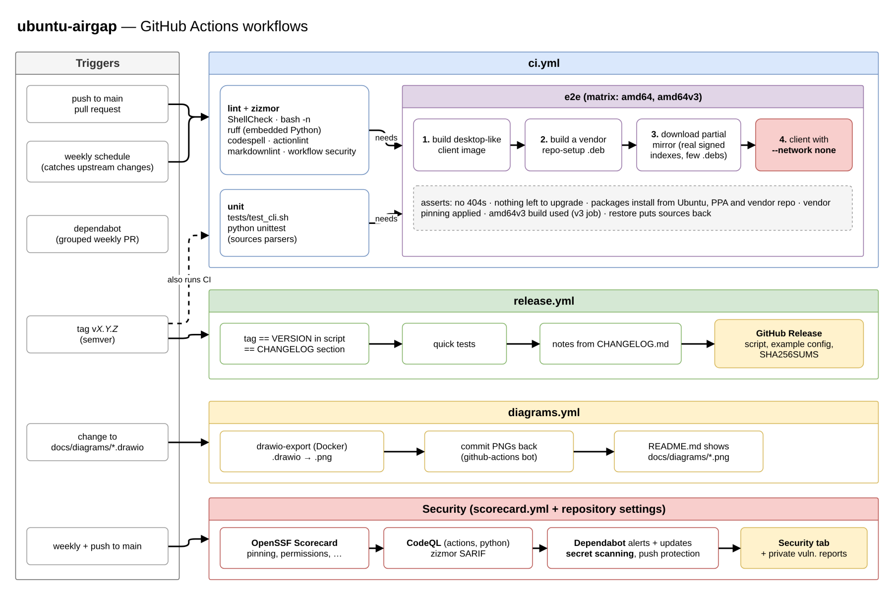

# ubuntu-airgap

[](https://github.com/636B65/ubuntu-airgap/actions/workflows/ci.yml)
[](https://github.com/636B65/ubuntu-airgap/releases/latest)
[](https://scorecard.dev/viewer/?uri=github.com/636B65/ubuntu-airgap)
[](LICENSE)

Keep an **air-gapped Ubuntu 26.04 LTS** ("resolute") machine up to date with a
**real Ubuntu mirror** that you carry over on a disk. One script does both sides:

| Where | Command | What happens |
|---|---|---|
| Online machine | `./ubuntu-airgap.sh download -d /media/disk/mirror` | Starts an `ubuntu:26.04` Docker container that builds/refreshes a mirror (`dists/` + `pool/`, the original **signed** `InRelease` files) with `debmirror`, plus any extra repositories, PPAs and vendor repos you add. |
| Air-gapped machine | `sudo /media/disk/mirror/ubuntu-airgap.sh install` | Serves the mirror with `python3 -m http.server`, points apt at it, runs `apt update` and `apt upgrade`. |

It is **not** an apt cache that gets copied around. The disk holds a normal Ubuntu
archive layout. apt on the air-gapped machine checks it with the regular
`ubuntu-archive-keyring`, exactly as it would check `archive.ubuntu.com`. There is
no `trusted=yes` and no re-signing.



<sub>Source: [`docs/diagrams/architecture.drawio`](docs/diagrams/architecture.drawio).
Open it in [draw.io](https://app.diagrams.net/) to edit. CI renders the PNG.</sub>

## Features

- Real Ubuntu mirror: signed `InRelease`/`Release.gpg`, `by-hash` indexes,
  AppStream (`dep11`) and `command-not-found` metadata, so a desktop's
  `apt update` gets no 404s.
- Incremental: running `download` again fetches only what changed and removes
  packages that are no longer in the archive.
- amd64 only, with optional **amd64v3** (x86-64-v3 optimised builds). Clients pick
  them up automatically when their CPU supports them.
- Extra sources, each mirrored in full and verified with its own key:
  - `--repo`: any normal apt repository plus its signing key.
  - `--ppa owner/name`: the same as `add-apt-repository ppa:owner/name`. The key is
    resolved through Launchpad and its fingerprint is verified.
  - `--repo-deb URL|FILE`: for vendors who ship a "repo setup" `.deb`. The package
    is unpacked (not installed), and the apt sources, keys and **apt pinning** inside
    it are used.
- The air-gapped side needs only what Ubuntu Desktop already has: `bash`, `apt` and
  `python3`.
- Reversible: `restore` puts the original apt sources back.

## Requirements

| Online machine | Air-gapped machine |
|---|---|
| Linux with Docker (any distro), `bash` | Ubuntu 26.04 (amd64) |
| Internet access | `python3` (installed by default on Ubuntu Desktop) |
| Disk space, see [Sizes](#sizes) | Read access to the mirror disk |

## Quick start

```bash
# Online machine
git clone https://github.com/636B65/ubuntu-airgap.git && cd ubuntu-airgap
./ubuntu-airgap.sh download -d /media/$USER/AIRGAP/mirror --dry-run   # show the size
./ubuntu-airgap.sh download -d /media/$USER/AIRGAP/mirror             # download

# Air-gapped machine (the script is copied into the mirror)
sudo /media/$USER/AIRGAP/mirror/ubuntu-airgap.sh install
```

Later, run the same `download` command again to refresh the disk, then run
`install` again on the air-gapped machine.

## Sizes

These are amd64 binaries only (no sources), measured in November 2026 for
`resolute`, `resolute-updates` and `resolute-security`. The archive grows over the
release's lifetime.

| Components | amd64 | amd64 + amd64v3 |
|---|---|---|
| `main,restricted` | ~100 GiB | — |
| `main,restricted,universe,multiverse` (default) | ~251 GiB | ~332 GiB |

Use `--dry-run` to see the exact number before downloading.

## Download options

```text
-d, --dest DIR            Where the mirror is written (required)
-c, --config FILE         Bash-style config file (see airgap.conf.example)
--release NAME            Ubuntu codename (default: resolute)
--suites LIST             Default: RELEASE,RELEASE-updates,RELEASE-security
--backports               Also mirror RELEASE-backports
--components LIST         Default: main,restricted,universe,multiverse
--amd64v3                 Also mirror the amd64v3 variant
--contents                Also mirror Contents-* (for apt-file)
--ubuntu-mirror URL       Upstream mirror (default: http://archive.ubuntu.com/ubuntu)
--repo SPEC               Extra repository (repeatable)
--ppa OWNER/NAME          Launchpad PPA (repeatable)
--repo-deb URL|FILE       Repositories from a vendor repo-setup .deb (repeatable)
--package-filter REGEX    Only download .debs whose path matches (tests/partial mirrors)
--image IMAGE             Docker base image (default: ubuntu:26.04)
--dry-run                 Fetch indexes only and report the download size
--debmirror-arg ARG       Extra debmirror argument (repeatable)
```

Run `./ubuntu-airgap.sh help` for the full text.

### Extra repositories

```bash
# A normal apt repository and its signing key (URL or local file, armored or binary)
--repo "name=docker;url=https://download.docker.com/linux/ubuntu;suites=resolute;components=stable;key=https://download.docker.com/linux/ubuntu/gpg"

# A PPA: what you would otherwise do with "sudo add-apt-repository ppa:git-core/ppa"
--ppa git-core/ppa

# A vendor package that normally sets up its repo, e.g. "vendor-install_1.0_all.deb"
--repo-deb https://example.com/downloads/vendor-install_1.0_all.deb
--repo-deb ./vendor-install_1.0_all.deb
```

How `--repo-deb` works:

1. The `.deb` is unpacked with `dpkg-deb -x`. Nothing is installed and no
   maintainer scripts run.
2. Every `deb` entry is read from `etc/apt/sources.list.d/*.list` and `*.sources`
   (one-line and deb822 formats, including inline `Signed-By` keys).
3. Each repository is mirrored into `repos/<package>-<n>/` and verified with the
   key from the `signed-by` path inside the package. If an entry has no
   `signed-by`, every key the package ships is used.
4. `etc/apt/preferences.d/*` pin files are copied too and installed on the client,
   so vendor priorities (`Pin: release o=Vendor`) still work offline.
5. The `.deb` itself is stored in `setup-debs/`. On the air-gapped machine,
   `install --install-setup-debs` installs it (to get the vendor's tool) and then
   disables the online sources it adds.

Limitations: flat repositories (no `dists/` directory) are not supported, and
neither are keys that the package downloads at install time.

### Config file

```bash
cp airgap.conf.example airgap.conf   # edit it
./ubuntu-airgap.sh download --config airgap.conf
```

## Air-gapped machine

```text
sudo ./ubuntu-airgap.sh install [options]
  -m, --mirror DIR          Mirror directory (default: where the script is)
  -p, --port PORT           HTTP port (default: 8080)
  --full-upgrade            "apt full-upgrade" instead of "apt upgrade"
  -y, --yes                 Don't ask
  --no-upgrade              Configure + apt update only
  --keep-serving            Keep serving after the upgrade (to apt install more)
  --no-phased-all           Respect phased updates (default: take all updates)
  --install-setup-debs      Install the vendor .debs from --repo-deb

./ubuntu-airgap.sh serve [--bind 0.0.0.0] [-p PORT]   # serve only (e.g. for apt install)
sudo ./ubuntu-airgap.sh restore                       # undo everything
```

`install` changes these files:

| File | Purpose |
|---|---|
| `/etc/apt/sources.list.d/ubuntu-airgap.sources` | deb822 sources pointing at `http://127.0.0.1:PORT/…` |
| `/etc/apt/apt.conf.d/90ubuntu-airgap` | phased updates, amd64v3 (`APT::Architecture-Variants "auto"`) |
| `/etc/apt/keyrings/airgap-*.gpg` | keys for the extra repositories |
| `/etc/apt/preferences.d/ubuntu-airgap-*` | pinning from vendor repo-setup packages |
| `/var/backups/ubuntu-airgap/<date>/` | the original apt sources, which are disabled while offline |
| `/var/log/ubuntu-airgap-http.log` | HTTP server log; any 404s are reported after apt runs |

To install more packages later, run `sudo ./ubuntu-airgap.sh serve` in one terminal
and `sudo apt install …` in another. You can also use `install --keep-serving`.

To share one mirror with several air-gapped machines on an isolated LAN, run
`serve --bind 0.0.0.0` on the machine that has the disk. On the other machines,
use the generated `/etc/apt/sources.list.d/ubuntu-airgap.sources` (plus any
`/etc/apt/keyrings/airgap-*.gpg`), with `127.0.0.1` replaced by that machine's IP.

### amd64v3

Ubuntu 26.04 publishes x86-64-v3 builds (AVX2, BMI2, FMA, …) for part of the
archive. Packages without a v3 build fall back to the normal amd64 `.deb`. If the
mirror was built with `--amd64v3`, the client gets `Architectures: amd64 amd64v3`
and `APT::Architecture-Variants "auto"`. apt then uses the v3 builds only when
`/proc/cpuinfo` shows the CPU supports them. Older CPUs keep using plain amd64
from the same mirror.

## Security model

- `debmirror` checks the GPG signature of every `Release` file against the
  Ubuntu archive keyring (or the extra repository's key), and checks the checksum
  of every index and package.
- The original signed files are kept unchanged. The air-gapped apt verifies them
  again with the keyring it already has, so a tampered disk is detected.
- `Check-Valid-Until: no` is set for the offline sources, because the clock on an
  air-gapped machine may drift and the mirror ages between refreshes.
- PPA keys are fetched from `keyserver.ubuntu.com`, and their fingerprint must
  match the one Launchpad reports for that PPA.
- The download container runs as your user, not root, so the files on the disk
  belong to you.
- **The disk is trusted** for the script itself, which runs as root, and for the
  keys of extra repositories, which are installed from the disk. Ubuntu packages
  do not depend on this, because they are checked against the keyring already on
  the machine. See [SECURITY.md](SECURITY.md) for the full trust model and how to
  report a vulnerability.

## Not covered

- **Snaps** (for example Firefox and the Snap Store) are not apt packages, so they
  are not updated by this tool.
- **i386 / multiarch** packages: only amd64 (and optionally amd64v3) is mirrored. If
  i386 is enabled, `install` prints a warning.
- Ubuntu Pro / ESM repositories need authentication and are not mirrored.

## Development

```bash
tests/test_cli.sh                                   # fast CLI tests
python3 -m unittest discover -s tests -v            # embedded Python helper
tests/e2e.sh                                        # full offline test (Docker, ~300 MB download)
AMD64V3=1 tests/e2e.sh                              # same, with the amd64v3 variant
```

The end-to-end test builds a *partial* mirror with `--package-filter`: every index
is real and signed, but only the `.deb` files the test needs are downloaded. It
mirrors the Ubuntu archive, a PPA and a repo-setup `.deb` that the test generates.
It then upgrades and installs packages in a container started with
`--network none`, and finally runs `restore`.

What has been verified so far:

- Tested in containers on a partial mirror (the e2e test above, on an ext4/btrfs
  host disk), with an Ubuntu 26.04 container made desktop-like (`appstream`,
  `command-not-found`, translations enabled).
- Not yet tested: a full-size mirror download, a real Ubuntu Desktop install, or
  mirrors on exFAT/NTFS disks. Hard links fall back to copies there, which is
  implemented but not tested.

CI runs ShellCheck, ruff, codespell, actionlint, markdownlint, zizmor (workflow
security), the unit tests and the end-to-end test (amd64 and amd64v3) on every
push, and once a week to catch upstream changes. CodeQL, OpenSSF Scorecard,
Dependabot and secret scanning report to the repository's Security tab. All
actions are pinned to commit SHAs.

### CI workflows



To edit a diagram, change the `.drawio` file. The `Diagrams` workflow renders it to
PNG with draw.io and commits the result back to `main`.

### Releasing

This project uses [Semantic Versioning](https://semver.org/). To release:

1. Update `VERSION="x.y.z"` in `ubuntu-airgap.sh`.
2. Add a `## [x.y.z]` section to `CHANGELOG.md`.
3. Commit, then `git tag vx.y.z && git push --tags`.

The release workflow checks that the tag, the script and the changelog all agree,
then publishes the script with its SHA256 sums.

## License

[MIT](LICENSE)
